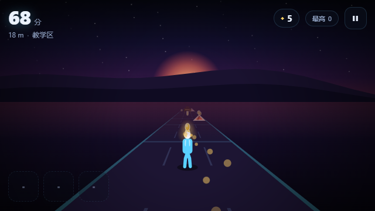

# 轨道无限跑酷 · Rail Runner

**在线试玩 → <https://gubao-tian.github.io/rail-runner/>**

> 不是更好玩的跑酷，而是更讲道理的跑酷。

三轨无限跑酷，**纯 Web 实现、零依赖、零素材、离线可玩**。按
[`轨道无限跑酷-PRD-V2.0`](./docs/PRD-V2.0.md) 的 P0 需求实现，手感参数、状态机、
关卡生成规则、存档策略全部与 PRD 对齐；交付前用 161 项离线断言 + 浏览器内自检 +
6×240km 完美玩家通过性模拟做过验证。



---

## 快速开始

**方式一：双击 `index.html`**（Chrome / Edge 均可）。没有构建步骤、没有 npm 安装、
不联网、不需要服务器。

**方式二：本地静态服务器**（存档最稳）：

```bash
cd 新文件
python -m http.server 8771
# 打开 http://127.0.0.1:8771
```

> 首次点击「开始游戏」后才会解锁音频（浏览器自动播放策略），属正常现象。

---

## 怎么玩

| 操作 | 键盘 | 触屏 |
| --- | --- | --- |
| 跳 | `↑` / `W` / `空格` | 上滑 / 轻点 |
| 滑铲 | `↓` / `S` | 下滑 |
| 换道 | `←` `→` / `A` `D` | 左右滑 |
| 用道具 | `1` `2` `3` / `Q` | 点左下道具格 |
| 暂停 | `Esc` / `P` | 右上暂停键 |

**三条规则就够：**

1. **橙色三角 = 跳过去**（低障碍）
2. **黄色横梁 = 滑过去**（高障碍，形状与颜色双重区分，色盲友好）
3. **两块都堵住 = 提前变道**（换道要 0.12 秒完成）

前 3 块地（0–90m）是保护区：纯金币 → 教跳 → 教滑，不会出现双轨障碍，判定宽容度
放大 1.5 倍。没有教程弹窗。

---

## 已实现的需求（对照 PRD 第 6 章）

| 编号 | 需求 | 状态 |
| --- | --- | --- |
| R-01 | 统一输入层（五指令） | ✅ `js/input.js` |
| R-02 | 防抖 / 滑动方向识别 / 指令冷却 | ✅ 60ms 同类冷却 + 主轴判定 |
| R-03 | 七状态互斥状态机 | ✅ `js/fsm.js`，附录 A 矩阵逐格实现 |
| R-04 | 两套碰撞体（常规 / 滑铲） | ✅ `Player.box()` |
| R-05 | 换道 120ms 且期间锁输入 | ✅ 实测 0.12s ± 1 帧 |
| R-06 | 地块池化复用 | ✅ 前向生成 + 尾部回收，常驻 < 40 块 |
| R-07 | 权重抽取 + 合法性校验 | ✅ `js/blocks.js`，运行时二次校验 |
| R-08 | 难度曲线驱动速度与权重 | ✅ `js/difficulty.js` |
| R-09 | 金币 / 连击 / 磁铁 | ✅ 连击倍率上限 5× |
| R-10 | 道具拾取入包 + 主动使用 | ✅ 护盾 / 磁铁 / 双倍，换道与受击时丢弃 |
| R-11 | 护盾抵挡一次 / 无护盾死亡 | ✅ |
| R-12 | 存档原子写入 / 损坏降级 / 结算即存 | ✅ 死亡瞬间落盘 |
| R-13 | 全局状态机 | ✅ 菜单/准备/对局/暂停/结算 |
| R-14 | HUD | ✅ 分数 / 距离 / 金币 / 道具栏 / 暂停 |
| R-15 | 结算面板 | ✅ 归因 + 最高分 + 再来一局 |
| R-16 | BGM 无缝续播 / 暂停衰减 / 音效开关 | ✅ 全合成音频 |
| R-17 | 相机跟随 / 撞击震动 / 冲刺拉近 | ✅ P1 |
| R-18 | 皮肤（里程解锁 + 预览） | ✅ P1，250 / 800 / 1500m |
| R-19 | 设置（音效 / 音乐 / 震动 / 画质） | ✅ P1 |
| R-20 | 死亡归因文案 | ✅ P1，六类归因 |
| R-21 | 分享图 | ⛔ P2，V1 不做 |
| R-22 | 每日固定种子 | ⛔ P2，V1 不做 |

**硬约束全部满足**：三轨只允许相邻换道；主状态互斥、空中禁止跳跃/滑铲、换道期间锁
全部输入；任意地块不三轨全封、不连续双轨；新手保护区规则；手感参数 100% 在
`js/config.js`；存档损坏降级不崩溃。

---

## 工程结构

```
index.html            页面骨架 + HUD/菜单/暂停/结算/设置
css/style.css         深色霓虹主题，刘海安全区适配
js/config.js          ★ 唯一手感参数源（改数值不改代码）
js/rng.js             确定性随机（同种子 = 同关卡）
js/difficulty.js      速度曲线 + 权重曲线
js/blocks.js          地块生成 + 合法性校验
js/fsm.js             七状态机（附录 A 矩阵）
js/collision.js       纯几何碰撞
js/save.js            原子存档 + 损坏降级 + 内存兜底
js/telemetry.js       本地埋点（JSONL 环形缓冲，不联网）
js/audio.js           WebAudio 合成音效与 BGM
js/input.js           键盘 / 触屏统一输入层
js/render.js          Canvas 伪 3D 透视渲染
js/game.js            编排：世界流 / 计分 / 死亡归因 / UI
js/selftest.js        ?selftest=1 浏览器内自检
js/main.js            启动 + 全局错误兜底
tools/logic-test.mjs  161 项离线断言 + 完美玩家通过性模拟
tools/balance-report.mjs  密度统计 → docs/balance-report.md/csv
tools/shot.mjs        从浏览器场景录制里提取截图（开发期小工具）
docs/                 平衡性报告、截图、PRD 副本
```

---

## 手感参数在哪调

全部在 `js/config.js`，例如：

```js
speed: { v0: 12.0, vMax: 26.0, lambda: 600 },  // 速度曲线
timing: { laneSwitch: 0.120, hitStun: 0.300, judgeWindow: 0.120 },
player: { jumpImpulse: 7.2, gravity: 21.0, slideDuration: 0.55 },
// 下蹲动作过渡 + 蹲姿形状
player: { crouchIn: 0.09, crouchOut: 0.22, crouchHipY: 0.34, crouchHeadY: 0.82 },
weightEnd: { empty: [0.45, 0.08], low: [0.25, 0.22], ... },
```

改动后跑一次 `node tools/logic-test.mjs`，任何破坏约束的修改都会当场失败。

### 下蹲为什么"柔和"

蹲姿不再是一帧切过去，而是一条 0→1 的权重曲线（`player.crouch`）：

- **进入 `crouchIn` = 90ms**：髋部下沉、屈膝、躯干变矮变宽，几个量一起插值，没有硬切；
- **离开 `crouchOut` = 220ms**：起身慢慢回正，不会"啪"地弹起来；
- **只降重心，不前倾**：躯干始终竖直，看起来是"蹲下去"，不是"扑出去"；
- **判定不跟着变慢**：按下滑铲的第一帧判定就切到蹲姿碰撞体，起身时要等姿态回到
  25% 以下才恢复站立碰撞体 —— 所以只会更宽容，绝不会出现"看着蹲下了却被判站姿"
  的冤枉死；
- **空中一律按站姿**：跳起来就不能再钻横杆，避免这条缓动被当成漏洞。

调 `crouchIn` / `crouchOut` 改变"软硬"；`crouchHipY` / `crouchHeadY` / `crouchWidth`
控制蹲多深、头多低、身子多宽。

---

## 验证

### 1. 离线断言（161 项）

```bash
node tools/logic-test.mjs
```

覆盖：速度曲线对照 §5.3 表格、权重总和与双轨锚点、20000 块地约束校验、附录 A 矩阵
逐格、换道 120ms、跳跃顶点与滞空、碰撞几何、存档四级降级、以及 **6 个种子 × 240km
的完美玩家通过性模拟（无解率 0）**。

### 2. 浏览器内自检

打开 `index.html?selftest=1`，页面会跑 11 项检查（含 30 秒集成模拟），结果同时写入
控制台与页面；标题变为 `SELFTEST PASS` 即通过。

### 3. 平衡性报告

```bash
node tools/balance-report.mjs   # → docs/balance-report.md / .csv
```

### 4. 调试参数

- `?autoplay=1`：跳过菜单直接开局（截图 / 回归用）
- `window.RR_GAME`：控制台可直接查看当前对局状态

---

## 与 PRD 的偏差（诚实清单）

1. **平台**：PRD 的主版本是 Unity，试玩版是 three.js。本环境无法构建、无法运行
   Unity，因此交付**纯 Web 版**（无 three.js 依赖）。玩法数据层、状态机、生成规则与
   PRD 一一对应，迁 Unity 时照搬 `config/difficulty/blocks/fsm` 即可。
2. **离线校验语言**：§9.3 写的是 Python，这里用 Node 实现同一套跑批。关键约束是
   "校验脚本必须读同一份 GameConfig"，这一点已满足；换成两套语言反而会漂移。
3. **结算页**：附录 A.2 写"3 秒后自动重开"，实现为"随时可点/按空格重开 + 3 秒提示"。
   自动重开会打断玩家读死亡归因，而 PRD §5.5 的核心诉求正是"死得明白"。
4. **双轨权重**：§5.3 同时给了"线性升至 0.30"和一张非线性表格。按"表格更具体"取
   表格锚点分段线性（100m 0%、250m 6%、500m 14%、750m 20%、1000m 24%、1500m 30%），
   其余权重按附录 B 端点线性插值后归一化。
5. **存档原子性**：Unity 的"临时文件 + 改名"映射为 localStorage 的
   `tmp → 主键 → 回读校验 → 备份键 → 清理`，语义等价；存储不可用时降级为内存存档。
6. **音频**：PRD 允许 CC0 素材，这里更进一步——全部用 WebAudio 实时合成，交付包里
   没有任何音频文件，也就没有素材授权风险。

---

## 已知限制

- 无联网、无排行榜、无云存档（PRD 非目标）。
- 未做移动端真机帧率实测；渲染已限制 DPR、提供低画质档位。
- `file://` 下部分浏览器（Safari）会禁用 localStorage，此时存档仅保存在内存中，
  刷新即丢；用本地服务器打开即恢复正常。
- 分享图（R-21）与每日种子（R-22）按 PRD 划入 P2，V1 未实现。

---

## 许可

代码 MIT。美术与音频均为运行时程序化生成，无第三方素材，详见 [LICENSES.md](./LICENSES.md)。
